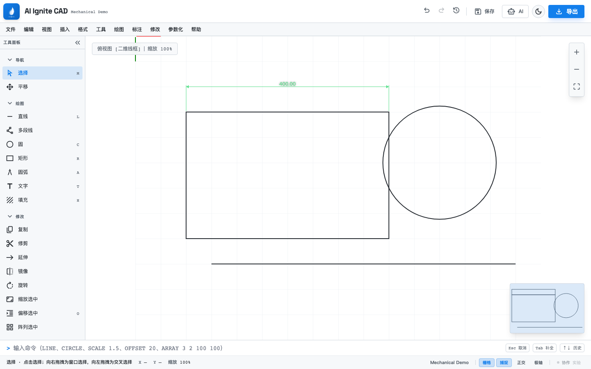
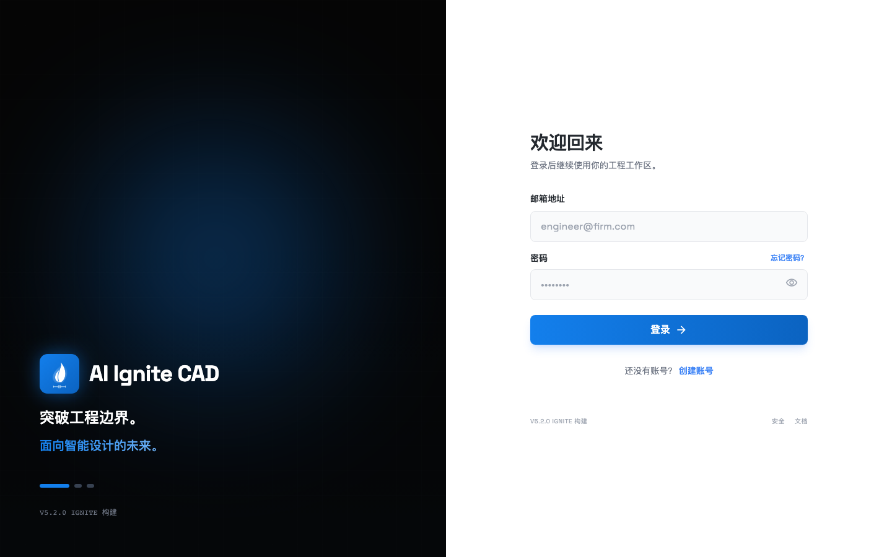
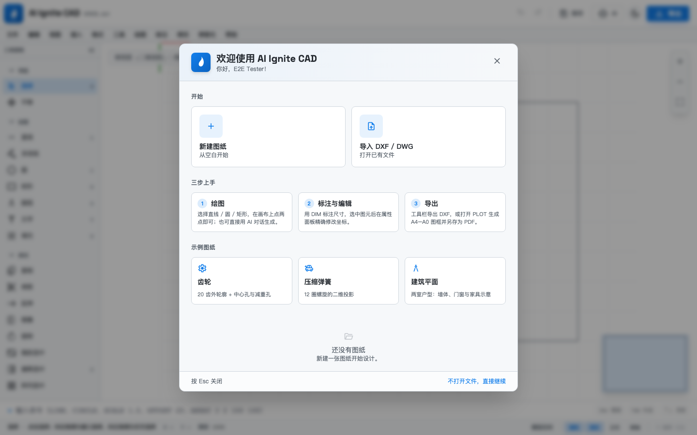
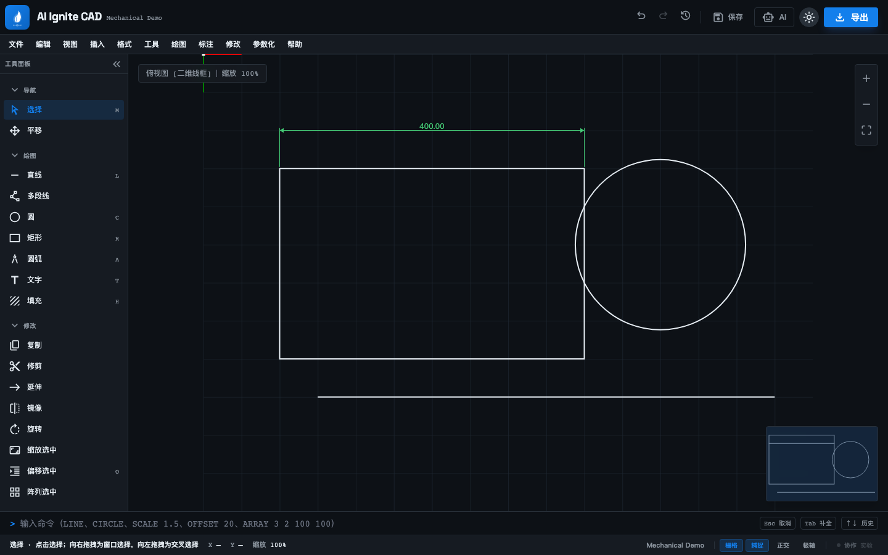
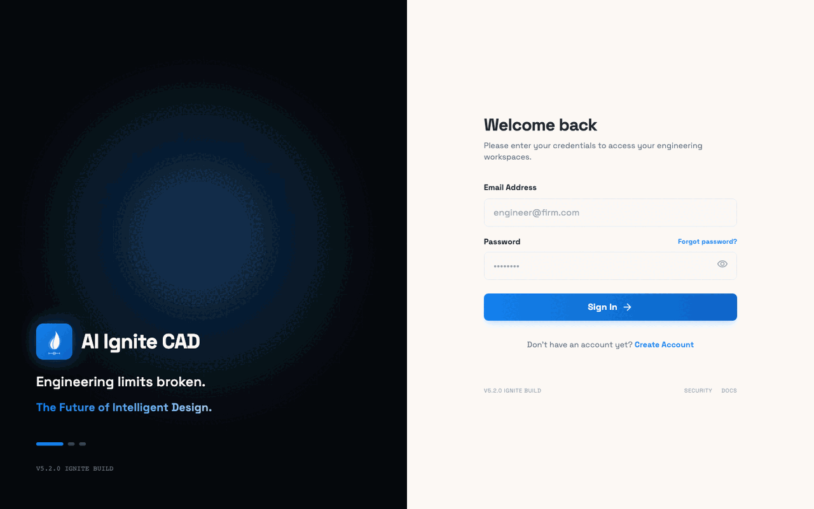

# AIIgniteCAD

> 浏览器里的 AI 辅助 2D CAD：自然语言绘图、DXF / DWG 导入与 DXF 导出、块系统、离线优先同步。

[](https://github.com/aiignite/AIIgniteCAD/actions/workflows/ci.yml)
[](LICENSE)
[](https://react.dev/)
[](https://www.typescriptlang.org/)
[](https://nodejs.org/)



## 90 秒跑起来

```bash
npm install && (cd backend && npm install)
cp .env.example .env && cp backend/.env.example backend/.env
git config core.hooksPath .githooks   # 阻止 .env 被误提交
docker compose up -d db
(cd backend && npx prisma migrate deploy && npx prisma generate)
./start.sh                    # 前端 http://localhost:3220 · 后端 http://localhost:3225
```

打开首页 → 注册 → 在欢迎页选择「示例图纸」（齿轮 / 弹簧 / 建筑平面）→ 导出 DXF。**无需 LLM API Key**：绘图、DXF 导入导出、离线保存全部可用；DWG 导入需要 Docker Compose 启动 LibreDWG 转换器。配置模型后才启用 AI 对话。

目录：[功能特性](#功能特性) · [快速开始](#快速开始) · [系统架构](#系统架构) · [AI](#ai模型助手技能与工具循环) · [离线同步](#离线优先与同步) · [版本历史](#版本历史) · [图框打印](#图框与打印) · [可观测性](#可观测性) · [API 安全](#api-安全) · [命令与快捷键](#命令与快捷键) · [技术栈](#技术栈) · [项目结构](#项目结构) · [测试](#测试与质量门禁) · [文档索引](#文档索引) · [已知限制](#已知限制) · [贡献](#贡献与许可证)

## 功能特性

| 模块       | 能力                                                                                                                                        |
| ---------- | ------------------------------------------------------------------------------------------------------------------------------------------- |
| 绘图       | 直线、多段线、圆、圆弧、矩形、文字、图案填充（11 种）                                                                                       |
| 编辑       | 选择、移动、复制、修剪、镜像、旋转、缩放、偏移、矩形阵列、夹点编辑                                                                          |
| 标注测量   | 线性尺寸标注、距离测量                                                                                                                      |
| 参数化图形 | 齿轮、渐开线、螺旋、弹簧、正多边形、椭圆；正弦 / 余弦、对数螺旋、二次 / 三次贝塞尔曲线，生成后自动校验                                     |
| 块系统     | 块定义 / 引用、嵌套与循环引用检测、旋转 / 缩放 / 镜像、分层块库                                                                             |
| 文件与输出 | DXF 导入导出（LINE / CIRCLE / ARC / LWPOLYLINE / TEXT / ELLIPSE / INSERT 块 / MTEXT / DIMENSION）；DWG 经 LibreDWG sidecar 转 DXF 后导入；图框打印 A4–A0 / Letter、横竖版、适配或固定比例、标题栏、单色矢量输出 |
| AI         | 模型注册表 + 解析链与故障转移、助手（系统提示 / 工具白名单 / 轮次上限）、技能路由与导入导出、Agent 工具循环、计划与多方案、服务端会话与用量台账 |
| 界面语言   | 默认中文，可切换英文；主界面、对话框、通知与 AI 对话主流程使用同一套扁平字典，切换结果写入 `localStorage` |
| 参考图     | 本地参考图转 CAD：阈值提取轮廓 + 简化，生成多段线到 TRACE 图层（图片不上传）                                                               |
| 存储同步   | IndexedDB 本地优先 + PostgreSQL 云端同步；幂等重放与冲突提示                                                                               |
| 协作与组织 | JWT 鉴权、项目隔离、图层管理、版本历史（自动 / 手动、对比、可撤销恢复）、图纸检查面板与设计约定；实验性实时协作（房间广播图元差集与光标，默认关闭，[ADR 0012](docs/adr/0012-experimental-collaboration.md)） |

### 界面一览

| 登录                             | 欢迎 / 最近文件                      | 暗色主题                                 |
| -------------------------------- | ------------------------------------ | ---------------------------------------- |
|  |  |  |



> 截图与演示 GIF 均由真实 UI 生成：`npm run docs:screenshots`（`tests/e2e/screenshots.spec.ts`）、`npm run docs:gif`（`npm run docs:frames` 录制 10 帧，每帧 3 秒）。

## 快速开始

```bash
# 两个终端
(cd backend && npm run dev)   # http://localhost:3225
npm run dev                   # http://localhost:3220
```

- **数据库凭据要一致**：根目录 `.env` 的 `POSTGRES_USER` / `POSTGRES_PASSWORD` / `POSTGRES_DB` 必须与 `backend/.env` 的 `DATABASE_URL` 对应。
- **生产必须换密钥**：`JWT_SECRET` 与 `ENCRYPTION_KEY`（各 `openssl rand -hex 32`）；生产环境未设置 `JWT_SECRET` 时服务拒绝启动。
- **Docker 一键**：`cp .env.example .env` 填好密钥后 `docker compose up -d --build`，数据库连接由 Compose 注入。
- **验证路径**：`curl http://localhost:3225/health` → 注册 → `New Drawing` → 画一条线 → `Export` 得到含 `ENTITIES` 的 `.dxf` → 保存后刷新可从服务端恢复。

前置条件、AI 模型配置步骤与故障排除（端口占用、Prisma Client 未生成、401 / CORS、AI 无响应错误码）见 [QUICKSTART.md](QUICKSTART.md)；提示词示例见 [examples/ai-prompts.md](examples/ai-prompts.md)。

## 系统架构

```
React 19 + Vite（SVG 画布）
  components/  Canvas · Toolbar · RightPanel · PropertyInspector · Footer · chat/
  store/       canvasStore（命令式撤销）· appStore（用户 / 文件 / 通知）
  hooks/       useCanvasInteraction · useAIChat（Agent 工具循环）· useAIRegistry · useCollaboration
  lib/         geometry · transform · selection · snapping · command
               aiTools · aiAgentLoop · aiActions · aiPlan · aiContext · aiSseEvents
  services/    dxf · block · hatch · advancedShapes · indexedDB · sync · api · telemetry
        │ REST / SSE · Socket.IO（实验性协作）
Express + Prisma（JWT）
  routes/      auth · projects · versions · blocks · llm · llmChat · chat
               assistants · skills · metrics · telemetry
  services/aiEngine/  modelResolver（解析链 + 故障转移）· promptComposer
               skills（规则路由）· contextManager（摘要 / 压缩）· toolValidator
               usageAccounting（token 台账）· providers/
  lib/         logger（JSON 日志）· metrics（进程内指标）· crypto
        │
PostgreSQL 15（18 张表）
```

`lib/` 为不依赖 React 与浏览器 API 的纯函数层，副作用与 IO 在 `services/`；各绘制工具是 `tools/` 里实现 `CanvasTool` 的独立状态机。更完整的模块边界与设计取舍见 [docs/architecture](docs/architecture/) 和 [ADR](docs/adr/)。

## 界面语言与菜单

- 默认中文，页头语言按钮在中 / EN 之间切换，选择写入 `localStorage`，刷新后保持；不跟随浏览器语言，避免国内用户首次打开看到英文。
- 文案集中在 `lib/i18n.tsx` 的扁平字典：`TranslationKey` 由中文字典推导，英文必须实现同一组键，单元测试校验键集合一致、无空文案与插值行为。
- 需要跨层复用的确定性文案（如图纸检查的问题描述）接收 `ReviewLocale` 参数，不在 `lib/` 引入 React。
- 布局保持「左侧工具条 + 右侧检查器 + 底部命令行」三区；顶栏只保留高频与全局动作（撤销 / 重做、保存、AI、语言、主题、导出），文件类动作收进「文件」菜单：导入 DXF / DWG、参考图转 CAD、导出 DXF、打印 / 绘图、版本历史、保存版本（[ADR 0020](docs/adr/0020-i18n-and-header-menu.md)）。

## AI：模型、助手、技能与工具循环

AI 通过 OpenAI / Anthropic / Google / Ollama 四种 Provider 调用。后端把 CAD 工具定义随请求发送给模型，以 SSE 流式回传文本与工具调用；工具在**浏览器侧的虚拟画布副本**上执行，模型每轮一次 HTTP 请求，回传结果后续跑下一轮。

AI 生成的变更在确认前先以**幽灵层**画在真实图纸上：紫色虚线是提议结果、红色虚线是将被移除的现状。预览弹窗可收起为底部工具条，在图纸上下文中核对落点；确认后按差分增量一次 `commitAction`，整批动作仍只占一步撤销。

对话不再占用右侧栏：页头 **AI** 图标打开非模态浮窗，浮窗可拖动、八向缩放，也可一键切换为贴右抽屉；助手 / 技能 / 模型 / 会话按钮在对话内以抽屉展开，画布始终保持可操作。输入时防抖解析**候选技能**并显示分数与命中原因，可逐项移除后再发送；候选与回合激活共用同一套后端打分。详见 [ADR 0019](docs/adr/0019-ai-window-and-skill-candidates.md)。

### CAD 工具（31 个，前后端定义一致）

| 工具                                                                                        | 作用                                                                  |
| ------------------------------------------------------------------------------------------- | --------------------------------------------------------------------- |
| `draw_line` / `draw_polyline` / `draw_rectangle` / `draw_circle` / `draw_arc` / `draw_text` | 创建图元                                                              |
| `draw_dimension` / `dimension_chain`                                                        | 线性标注 / 连续标注                                                   |
| `move_elements` / `rotate_elements` / `copy_elements` / `mirror_elements`                   | 变换选中对象                                                          |
| `scale_elements` / `offset_elements` / `array_elements`                                     | 缩放 / 偏移 / 矩形阵列                                                |
| `align_elements` / `distribute_elements`                                                    | 对齐 / 等距分布                                                       |
| `assign_layer` / `delete_elements`                                                          | 设置图层 / 删除指定图元                                               |
| `clear_canvas` / `delete_last`                                                              | 清空 / 删除最后一项                                                   |
| `get_canvas_info`                                                                           | 只读：读取当前画布统计                                                |
| `query_elements`                                                                            | 只读：按类型 / 图层 / 文本 / 范围查询图元                             |
| `measure_geometry`                                                                          | 只读：测量距离、长度、面积与包围盒                                    |
| `check_drawing`                                                                             | 只读：检查几何退化、重复、文字重叠、图层组织与缺失标注                |
| `list_blocks`                                                                               | 只读：检索块库中的可复用符号（名称 / 分类 / 描述）                     |
| `insert_block`                                                                              | 按块库 id 插入符号，支持缩放与旋转                                    |
| `insert_block_by_name`                                                                      | 按自然语言中的块名插入；同名歧义时列出候选，避免插错                  |
| `save_selection_as_block`                                                                   | 把选中图元保存为块库条目（可带描述与基点），确认后在服务端执行        |
| `save_version`                                                                              | 把当前图纸保存为一个版本，确认后在服务端执行                          |
| `zoom_to_selection`                                                                         | 视图：缩放到指定图元或当前选择集                                      |
| `propose_plan`                                                                              | 计划模式专用：提交带工具与参数的执行计划，等待用户确认                |
| `propose_variants`                                                                          | 多方案模式专用：提交 2–3 个备选方案（名称、摘要、步骤），等待用户选择 |

### 契约、校验与拒绝回环

- 前端优先消费结构化 `tool_call`；模型不支持工具调用时自动降级解析文本 JSON，两条路径都有测试。
- **单一事实源**：跨包契约由服务端下发或由同一份工具定义生成，前端不维护副本。轮次上限取 `assistant.maxToolRounds`（默认 4，可配 0–12），经 `context` 事件下发；前端本地硬上限 8，拿不到该事件时回落到 4——宁可少跑一轮也不打 400。
- **参数先校验，作用域后解析**：参数在服务端 `toolValidator` 收紧，非法调用被拒绝并**定位到具体字段**（如 `array_elements.rows 不能小于 1`）；编辑类工具省略 `ids` 时作用于用户确认时的当前选择集。
- **拒绝也要闭环**：被拒调用与其原因一起回传模型，assistant 与 tool 消息按 provider 要求一一配对，模型能自纠错而不是盲猜重试；失败调用同样占单轮额度（每轮最多 20 次）。同一 `tool + arguments` 连续重复时在结果里提示模型换个做法，但不直接拒绝。
- 破坏性操作（`CLEAR`、一次删除 ≥5 个图元）必须在预览弹窗中显式勾选确认；视图类工具只移动视口，不进预览、不占撤销步骤（[ADR 0011](docs/adr/0011-ai-view-tools-bypass-preview.md)）。机制取舍见 [ADR 0018](docs/adr/0018-ai-tool-contract-and-rejection-loop.md)。

### 计划、多方案与检查面板

- **计划模式**：显式规划、跨 3 类操作或大图整理请求自动进入。该轮只下发只读工具与 `propose_plan`，模型先确认现状再提交计划；提示词单独给出「计划步骤可引用的写工具」清单（由工具定义自动生成，与本轮可调用清单区分）。用户可在卡片中改标题、调顺序、删步骤，确认后由前端在草稿上执行写步骤，仍只弹一次预览、只占一步撤销（[ADR 0014](docs/adr/0014-design-ops-plan-and-review.md)、[ADR 0017](docs/adr/0017-ai-gap-closing-and-conventions-downstream.md)）。
- **多方案生成**：请求含「多方案 / 方案对比 / 备选」等意图时进入，该轮只下发只读工具与 `propose_variants`。模型返回 2–3 个方案，每个在草稿上独立执行并渲染缩略预览，卡片按**几何差分**显示「新增 N / 修改 M / 移除 K」而非模型自述；采用其一后只走一次预览、只占一步撤销，未采用的方案不落图。
- **图纸检查面板**：右侧导航「检查」基于同一套确定性规则列出错误 / 警告 / 提示，支持筛选、定位（选中并缩放）、忽略与「让 AI 修复」；修复请求只携带问题摘要与相关图元 id，不发送完整图元 JSON。
- **块与符号复用**：块库目录（`/api/blocks/tree`）在每轮请求前拉取并压成扁平目录（按项目缓存 60 秒，块或分类增删改后立即失效），模型先用 `list_blocks` 找可复用符号，再用 `insert_block` / `insert_block_by_name` 插入。按名字插入时前端做大小写无关的精确匹配与唯一子串匹配，多个候选会列出来让用户澄清；选中图元也可以经 `save_selection_as_block` 反向存入块库。插入与建块都在草稿上展开 / 收集为图元，沿用同一条预览与单步撤销管线；建块与 `save_version` 作为附加操作在预览里一并确认，不额外绕过确认流程。块库读取失败与空库是两种状态：不可用时明确回报「块库当前不可用……不是空库」，模型据此改走绘图工具而不是凭空重画库里已有的符号。

### 设计记忆与参考图

- **设计约定**：每个项目可保存制图标准、单位、字高、标注精度、图层命名规则与备注，随项目走 IndexedDB / 同步队列持久化（`projects.design_conventions`）；右侧导航「约定」维护，AI 每轮自动注入摘要。约定同时**下沉到确定性检查**：检查面板、AI 质量门禁与 `check_drawing` 都按约定核对图层归属与文字字高是否统一。
- **版本记忆**：创建版本时对比上一版快照，按轻量几何签名计算新增 / 删除 / 修改数量、类型分布与涉及图层，写入 `project_versions.change_summary`；最近 5 个版本连同提交信息注入 prompt，让 AI 知道「上一版改了什么」。
- **参考图转 CAD**：页头文件菜单「参考图转 CAD」打开，图片仅在浏览器本地用 `createImageBitmap` + Canvas 读取，不上传。按阈值提取轮廓（marching squares）、RDP 简化后生成 `LWPOLYLINE` 到 `TRACE` 图层，可调阈值 / 反色 / 简化强度 / 目标宽度，预览确认后一次插入并占一步撤销。能力来源见 [ADR 0015](docs/adr/0015-design-conventions-and-variants.md)。

### 质量门禁与反馈闭环

- **结果门禁**：预览弹窗在展示变更前先跑一遍与「检查」面板同源的确定性规则，只把**本轮新增**的问题算作 AI 引入（对比改动前后的结果差集，既有历史问题不追责）。出现错误级问题时「应用」按钮默认禁用，必须显式勾选「确认接受检查错误」；警告与提示只做提示，不阻断。
- **回答反馈**：每条 AI 回答下方有「有帮助 / 没帮助」两个按钮，「没帮助」可附带原因（不准确 / 不符合约定 / 改动多余）。反馈经 `POST /api/chat/turns/:turnId/feedback` 写回该轮助手消息的 metadata，不新增表；历史回放时状态一并还原。
- **技能有用率与采纳率**：`GET /api/skills/stats` 同时聚合主观反馈（up / down）与客观采纳（预览弹窗里点了「应用」还是「放弃」），按技能 code 给出 `helpfulRate` 与 `adoptionRate`；回执成功后立即刷新，无轮询。未评价的消息不计入有用率分母，未做决策的轮次不计入采纳率分母，避免把「没评价」当成差评。详见 [ADR 0016](docs/adr/0016-block-reuse-quality-gate-and-feedback.md)。

### 模型解析与故障转移

解析链固定为 **显式选择 → 会话绑定 → 助手模型 → 用户默认 → 系统默认 → 任一启用模型**，每步都校验归属（防止助手借用其他用户的密钥）与 `supportsTools`；实际使用的 provider 与模型通过 `trace_start` 事件回传前端展示，显式与会话级选择不可用时直接报错，不静默降级。

Provider 报错且**尚未吐出任何内容**时才按候选顺序换模型重试，切换时发出 `model_fallback` 事件；已经开始流式输出的响应不会静默重放。`AiCallLog` 记录 provider、模型、轮次、状态、错误码、token、成本、耗时、工具调用数与激活技能，回答「这个月花了多少、哪条链路在报错」。

### 助手与技能

- **助手**：系统提示词真正注入请求，并限定可用工具白名单与最大工具轮次；一个项目可切换助手而不改代码。
- **技能 Playbook**：内置种子技能在首次使用时按 code upsert 进 `ai_skills`（`isSystem=true`），与用户自建技能同库同表，可在技能面板停用、编辑或克隆。每个技能除提示词外还包含执行步骤、完成检查、示例请求、所需设计上下文与反关键词，**全部字段都会进入提示词**——步骤、检查、示例按技能成块输出，反关键词渲染成「不适用场景」；每次更新递增 `version`。
- **路由**：显式固定 > 候选保留 > 助手绑定 > 关键词 > 历史关键词衰减 > 会话连续性构成语言意图，选择集类型与设计上下文只在已有意图时加分，反关键词命中扣分；低于阈值不激活，最多 3 个，提示词字符有上限。当前消息无命中时回看最近 3 条用户消息（`0.5^depth` 衰减）；不足 8 字的“继续 / 好的”沿用上一轮技能。审查技能激活时本轮只下发只读工具（[ADR 0013](docs/adr/0013-skill-playbook-design-context.md)、[ADR 0019](docs/adr/0019-ai-window-and-skill-candidates.md)）。
- **只读设计工具**：`query_elements` / `measure_geometry` / `check_drawing` 在浏览器草稿上确定性执行，模型先查、再量、后回答；结果有字符预算裁剪，不会把非法 JSON 回传给模型。
- **写入校验三径合一**：技能编辑器手写路径、导入路径与后端共用同一套字段级校验（工具名白名单、上下文信号、长度与数值范围），错误定位到具体输入框而不是笼统 400。每个技能可导出为带版本号的 JSON（`aiignite-skill` / v1），导入时先在浏览器侧完整校验，代码被占用时自动追加副本后缀，落库前给出预览。

### 会话与上下文

- 会话与消息保存在服务端（`ChatSession` / `ChatMessage`），切图即切会话，刷新后历史完整回放，工具条目保留参数摘要与执行状态。幂等靠确定性 `clientMessageId`：`${turnId}`（用户）、`${turnId}:r{n}:assistant`、`${turnId}:r{n-1}:tool:${toolCallId}`（工具结果归属提议它的那一轮）。
- 发送给模型的画布上下文分 **brief / standard / deep** 三档：brief 档给出统计、选中 id 与一行事实（有无标注、块引用数、隐藏 / 锁定图层数）；standard 档增加图层可见性 / 锁定明细（截断时说明另有几个隐藏或锁定）、块引用、标注覆盖与修订号；审查、测量、布局类问题或大图扩展到最多 30 个选中图元。仍禁止倾倒全量 JSON。
- 每轮请求的 `blockCount` 计入「持久块引用 + 本轮草稿刚插入的块」，模型不会重复插同一个块。
- 长对话生成**确定性 digest** 写入 `contextSummary` 并记录水位线，早于水位线的消息不再逐条注入（不调用模型做摘要，保证可测试）。回合结束把 `applied` / `discarded`（带 `reason`，如 cancelled、stopped）、受影响图元 id 与本轮激活技能 code 回写到本轮用户消息的 metadata。
- 右侧面板保留 **检查 / 约定 / 文件 / 设置 / 用户** 视图；模型 / 助手 / 技能 / 对话迁入页头 AI 浮窗，助手、技能、模型共用一份注册表状态，写入后自动重拉（[ADR 0019](docs/adr/0019-ai-window-and-skill-candidates.md)）。

测试分层、用例与文件映射、指标名全清单见 [docs/guides/TESTING.md](docs/guides/TESTING.md)。日常门禁只需 `npm test` 与 `npm run test:e2e`，均无需真实 API Key 或数据库。AI 侧指标按「请求 / 失败 / 故障转移 / 重试、工具调用与拒绝、耗时与上下文规模、token 与成本、回合采纳与反馈、技能写入」分类统计；Provider 返回 usage 时直接记录，否则按 4 字符 ≈ 1 token 估算并标记 `usageEstimated`。

## 离线优先与同步

1. 每次编辑先写入 IndexedDB，再进入 `syncQueue`；不要绕过队列直接调用 API。
2. 同步请求携带客户端生成的 `Idempotency-Key`，后端按 key 去重，网络重试不会重复创建项目或元素。
3. 队列按项目合并为最新快照，避免离线期间的中间状态逐个上传。
4. 冲突采用**最后写入胜**，响应带 `conflict` 标记，前端提示「云端修改已被本次保存覆盖」。
5. 离线新建的项目在首次同步后由服务端 id 回填并迁移本地文件、当前文件与已保存快照。

## 版本历史

- 文件菜单「版本历史」打开版本面板，可命名保存当前图形；每 20 次提交自动创建版本，失败后 60 秒退避重试。
- 版本列表只返回元数据（版本号、`elementCount`、名称、时间）与 `+N / -M / ~K` 差异摘要，快照详情按需加载；分页以 `versionNumber` 为游标。
- 支持勾选任意两个版本对比，也支持当前图形与选中版本对比，结果统计新增 / 删除 / 修改数量及图元类型。
- 恢复版本通过 `commitAction` 写入撤销历史并立即持久化，恢复后可用 `Ctrl/Cmd + Z` 回退。
- 接口：`GET/POST /api/projects/:id/versions`、`GET /api/projects/:id/versions/:versionId`；均校验项目归属，版本号在事务内取 max + 1，唯一冲突返回 409。

## 图框与打印

- 文件菜单「打印 / 绘图」打开打印面板，支持 A4 / A3 / A2 / A1 / A0 / Letter 与横竖版，边距 5–30mm。
- 比例可选 **Fit to sheet** 或固定 1:1 / 1:2 / 1:5 / … / 1:1000；固定比例超出绘图区时会提示裁切。
- 可选图框与标题栏（图名、图号、比例、图幅、日期、作者）以及单色输出（白纸黑线）。
- 预览与打印共用 `components/PlotSheet.tsx`，布局统一走 `lib/plot.ts`，图元打印样式通过 `CADElementRenderer` 的 `overrides` 传入；输出为 SVG 矢量，在浏览器打印对话框选「另存为 PDF」即得矢量 PDF。
- 线宽按 0.25mm 换算到当前比例，打印时关闭 `non-scaling-stroke`，不同比例下线宽保持一致。

## 可观测性

| 端点 / 能力                  | 说明                                                                                                        |
| ---------------------------- | ----------------------------------------------------------------------------------------------------------- |
| `GET /health`                | 存活检查                                                                                                      |
| `GET /api/metrics`           | 计数器、gauge、直方图（P50 / P95 / P99）与派生比率（AI 失败率、SSE 中断率）；可用 `METRICS_TOKEN` 保护        |
| `POST /api/telemetry/events` | 前端错误、未处理 Promise、同步状态、AI 上下文统计批量上报                                                    |
| `ai_call_logs` 表            | 每次模型调用的台账：provider、模型、轮次、状态与错误码、token、成本、耗时、工具调用数、激活技能               |
| 全局 ErrorBoundary           | 渲染崩溃时提供重试、刷新、复制诊断信息三个出口，并上报组件栈                                                 |
| `X-Request-Id`               | 请求链路 ID，日志、错误响应与指标共用                                                                        |
| 结构化日志                   | 单行 JSON，敏感字段自动脱敏；`LOG_LEVEL=debug/info/warn/error`                                              |

指标与限流计数保存在**进程内存**，重启清零、多实例不共享。完整指标名清单见 [docs/guides/TESTING.md](docs/guides/TESTING.md)。

```bash
curl http://localhost:3225/api/metrics | jq
LOG_LEVEL=debug npm run dev   # backend/
```

## API 安全

- **限流**（超限返回 `429` 与 `Retry-After`、`RateLimit-*` 头；只读的 `GET /api/auth/me` 不计数）：认证写操作每 IP 每 15 分钟 20 次，`/api/llm/*` 每用户每分钟 30 次，`/api/chat/*` 每用户每 5 分钟 120 次，`/api/skills/*` 600 次 / 5 分钟，`/api/blocks/*` 300 次 / 5 分钟，`/api/import/dwg` 每用户每 10 分钟 20 次；额度分别由 `AUTH` / `AI` / `CHAT` / `SKILL` / `BLOCK` / `IMPORT` 前缀的 `RATE_LIMIT_MAX` 与 `RATE_LIMIT_WINDOW_MS` 调整，`RATE_LIMIT_DISABLED=true` 仅用于紧急排障。限流桶在进程内存，多实例部署需在网关层另行限制。
- `/api/llm/chat` 在触达数据库与 Provider 前做完整 Agent 回合校验：`phase` 只能是 `user_turn` / `tool_results`，`message` 必填且 ≤ 32000 字符，`round` 受绝对轮次上限约束，`turnId` / `sessionId` / `projectId` / `assistantId` / `modelId` ≤ 128 字符，`pinnedSkillCodes` ≤ 5 个，`canvasContext` 与 `toolResults` 各自有条数与长度上限——超限的回传内容直接 400，不会进入 prompt。
- 模型 API Key 以 AES-256-GCM 加密落库，响应只返回 `hasApiKey` 与 `maskSecret` 预览，`apiKeyEncrypted` 由 `serializers.ts` 统一剔除。
- 引用的模型必须归属当前用户（或系统内置 `userId=null`）且处于启用状态，否则解析链抛 `MODEL_FORBIDDEN` / `MODEL_DISABLED`。
- DWG 导入只接受 `application/octet-stream`，先校验 `AC10xx` 文件头，再转发给内网 `dwg-converter`；默认单文件 50 MB，转换器只挂在 compose 内网，不对外暴露端口。
- 模型 `baseUrl` 由 `urlGuard` 做 SSRF 校验：拒绝非 http(s) 地址，云元数据与链路本地地址始终拒绝；内网 / 回环默认只对 Ollama 或白名单放行，生产强制 https。局域网 OpenAI 兼容网关（如 CCSwitch）使用 HTTP 时开启 `AI_ALLOW_PRIVATE_ENDPOINTS=true`，仅 IP 字面量生效；内网域名需加入 `AI_ALLOWED_ENDPOINTS`。公网 HTTP 不会被这两个开关放行。
- helmet 输出严格 CSP（`default-src 'none'`）、一年期 HSTS、`X-Frame-Options: DENY`、`Referrer-Policy: no-referrer` 并关闭 `X-Powered-By`，安全头集中在 `backend/src/app.ts`。
- 生产环境未设置 `JWT_SECRET` 时服务拒绝启动；CI 对前后端执行 `npm audit --omit=dev --audit-level=high`，high / critical 生产依赖漏洞阻断合并。日志与错误响应不包含 API Key、密码、Authorization 头或完整请求体。

## 命令与快捷键

底部命令行支持 AutoCAD 风格缩写（大小写不敏感）。

| 命令                                     | 作用                             | 命令                                    | 作用                              |
| ---------------------------------------- | -------------------------------- | --------------------------------------- | --------------------------------- |
| `L` / `LINE`                             | 直线                             | `D` / `DIM`                             | 尺寸标注                          |
| `PL` / `POLYLINE`                        | 多段线                           | `DI` / `DIST`                           | 距离测量                          |
| `C` / `CIRCLE`                           | 圆                               | `CO` / `COPY`                           | 复制                              |
| `A` / `ARC`                              | 圆弧                             | `TR` / `TRIM`                           | 修剪                              |
| `R` / `REC`                              | 矩形                             | `MI` / `MIRROR`                         | 镜像                              |
| `T` / `TEXT`                             | 文字                             | `RO` / `ROTATE`                         | 旋转                              |
| `M` / `MOVE`                             | 移动 / 选择                      | `E` / `DEL` / `ERASE`                   | 删除选中                          |
| `SC` / `SCALE <倍率>`                    | 缩放选中                         | `O` / `OFFSET <距离>`                   | 偏移选中                          |
| `AR` / `ARRAY <行> <列> [列距] [行距]`   | 矩形阵列                         | `SA` / `SELECTALL`                      | 全选（跳过隐藏 / 锁定层与临时隐藏） |
| `LA` / `LAYER <名称>`                    | 切换或新建图层                   | `DS` / `DESELECT`                       | 清空选择                          |
| `ISO` / `ISOLATE`                        | 只保留选中图元                   | `HI` / `HIDEOBJECTS`                    | 隐藏选中图元                      |
| `SH` / `SHOWALL`                         | 显示被隐藏图元（含 `UNISO`）     | `SSI` / `SELECTSIMILAR`                 | 选择同类型图元                    |
| `Z` / `ZOOM E\|S\|W <x1> <y1> <x2> <y2>` | 缩放到范围 / 选择集 / 窗口       | `V` / `VIEW SAVE\|RESTORE\|LIST [名称]` | 命名视图                          |
| `QS` / `QSELECT`                         | 快速选择（类型 / 图层 / 颜色）   | `PLOT` / `PRINT`                        | 打开图框打印面板                  |
| `ORTHO` / `GRID` / `SNAP`                | 切换正交 / 栅格 / 捕捉           | `HELP [命令]`                           | 列出或查看命令用法                |
| `U` / `UNDO` · `REDO`                    | 撤销 / 重做                      |                                         |                                   |

交互：`Enter` 执行、留空时 `Enter` 重复上一条命令，必填参数缺失时进入分步输入；`Tab` 补全命令名；`↑` / `↓` 浏览历史（保留 50 条）；`Esc` 取消分步或清空输入。命令定义集中在 `lib/commands/builtins.ts`，新增命令无需改动 `App.tsx`。

| 快捷键                                  | 作用                                 |
| --------------------------------------- | ------------------------------------ |
| `Ctrl/Cmd + Z`                          | 撤销                                 |
| `Ctrl/Cmd + Y` / `Ctrl/Cmd + Shift + Z` | 重做                                 |
| `Ctrl/Cmd + C` / `Ctrl/Cmd + V`         | 复制 / 粘贴选中图元（连续粘贴逐次错开） |
| `Ctrl/Cmd + A`                          | 全选可见图元                         |
| `Ctrl/Cmd + S`                          | 保存当前图纸                         |
| `Ctrl/Cmd + P`                          | 打开打印 / 绘图面板                  |
| `Ctrl/Cmd + O` / `Ctrl/Cmd + N`         | 打开图纸管理弹窗                     |
| `Delete` / `Backspace`                  | 删除选中（≥5 个需确认，焦点在哪都生效） |
| `Esc`                                   | 取消当前工具 / 绘制                  |
| `Enter`                                 | 结束多段线；动态输入键入中则提交数值 |
| `F3` / `F7` / `F8` / `F10`              | 切换捕捉 / 栅格 / 正交 / 极轴        |
| `Shift + 点击`                          | 加选 / 减选图元                      |

单键换工具沿用 AutoCAD 键位：`L` 直线、`C` 圆、`R` 矩形、`A` 圆弧、`T` 文字、`H` 填充、`D` 标注、`O` 偏移、`M` 移动（选择工具）；`E` 删除、`G` 组合、`X` 解散组合。焦点在输入框或弹窗打开时不响应，映射集中在 `lib/shortcuts.ts`。

画布上单击右键弹出上下文菜单：有选择集时提供复制 / 粘贴、移动 / 拖拽复制 / 旋转 / 缩放 / 镜像 / 偏移 / 阵列、组合 / 解散 / 隐藏 / 隔离、问 AI 与删除；无选择集时提供全选、粘贴、缩放到范围与显示全部。右键拖拽仍是平移，不会误开菜单。

### 画布交互

- **状态栏是唯一提示位置**：按当前工具与已取点阶段输出「工具 · 下一步」，同时显示 X/Y、缩放与捕捉类型。
- **选择与命中**：选择 / 复制 / 修剪下光标经过图元即变浅蓝、点击转黄色选中，捕捉点以中文标签（端点 / 中点 / 圆心…）跟随光标；图元重叠时在同一位置 300ms 内重复点击可依次切换（后绘制者优先），多选下点击成员仍保留整个选择集。
- **绘制手感**：直线 / 矩形 / 圆既可拖拽也可点击留锚点、再点提交；已有锚点时直接键入数字，`Tab` 在长度 / 角度（或宽 / 高）间切换，`Enter` 按数值合成终点，`Esc` 放弃键入；「极轴」以 45° 增量、10° 容差吸附方向并显示引导线，与「正交」互斥。
- **选中集迷你工具栏**：选框上方浮出移动 / 复制 / 旋转 / 缩放 / 镜像 / 偏移 / 阵列 / 删除 / 问 AI，全部复用左侧工具栏的工具态；取消选择或进入工具流程即让位。「问 AI」把选择集摘要写成对话草稿并聚焦输入框。
- **隔离与同类**：`ISOLATE` / `HIDEOBJECTS` 写入独立的临时隐藏集——被隐藏图元不渲染、不参与捕捉与框选，但不改图层可见性、不占撤销步骤；状态栏显示「已隐藏 N」，点击它或 `SHOWALL` 恢复。`SELECTSIMILAR` 在当前可显示图元中按类型扩选。隐藏集只作用于屏幕，DXF 导出与打印仍按完整图纸。
- **视图与文档分离**：缩放 / 平移是瞬态视图状态，不进撤销历史也不标记图纸已修改；`ZOOM E/S/W` 分别取范围、追选择集、取窗口，`VIEW SAVE/RESTORE/LIST` 管理按图纸存于浏览器本地的命名视图。`QSELECT` 按类型 / 图层 / 颜色三维筛选（维度间取交集、同维度内取并集），底部实时显示收敛后的命中数。
- **导航图与分组**：画布右下角小地图缩略显示全部可显示图元并叠蓝色视口矩形，点击或拖拽即移动视口，不产生撤销步骤；左侧工具条按 导航 / 绘图 / 修改 常驻高频工具，其余收进「更多工具」溢出菜单并按 绘图 / 修改 / 标注 / 参数化 分组。

## 技术栈

- **前端**：React 19.2、TypeScript 5.8、Vite 6、Tailwind CSS 3.4、SVG 渲染、marked
- **后端**：Express 4、Prisma 5、PostgreSQL 15、Socket.IO（实验性实时协作，默认关闭）、JWT + bcryptjs、helmet
- **测试**：Vitest 5（前后端）、Supertest、Playwright 1.64
- **工程化**：ESLint 10（前端）/ 8（后端）、Prettier、Docker 多阶段构建 + Nginx、GitHub Actions

## 项目结构

```
AIIgniteCAD/
├── App.tsx                 # 应用编排：鉴权、项目、命令、模态框
├── components/             # Canvas / Toolbar / RightPanel / PropertyInspector · chat/
├── hooks/                  # useCanvasInteraction / useCommandInput / useAIChat / useCollaboration
├── tools/                  # 各工具状态机（Line / Polyline / Select / Trim ...）
├── renderer/               # Renderer 接口与 SvgRenderer（坐标换算 / 命中测试）
├── lib/                    # geometry / transform / selection / snapping / aiTools / commands
├── services/               # DXF / 块 / 填充 / 高级图形 / IndexedDB / 同步 / API / 遥测
├── store/                  # canvasStore（撤销历史）/ appStore（会话与文件）
├── scripts/                # generate-examples.mjs · make-demo-gif.sh
├── tests/                  # Vitest 单测 + e2e/（Playwright、截图与演示帧生成）
├── backend/
│   ├── prisma/             # schema 与 migrations
│   ├── src/                # routes / lib / middleware / services(cadEngine, aiEngine)
│   └── tests/              # Supertest + Prisma mock
├── dwg-converter/          # LibreDWG dwg2dxf sidecar（独立容器，GPL-3.0）
├── docs/                   # architecture / guides / reports / adr / images
└── examples/               # 可导入的 DXF 与 AI 提示词示例
```

## 测试与质量门禁

```bash
npm run lint && npm run typecheck && npm test && npm run build
(cd backend && npm run lint && npx tsc --noEmit && npm test)
npm run test:e2e                 # Playwright，无需数据库 / API Key
npm run docs:screenshots         # 重新生成 docs/images
```

- 前后端各有一套 Vitest 单测：`lib/` 纯函数在 Node 环境直测，后端用 Supertest 打 Express 实例、`vi.mock` 替换 Prisma。
- E2E 用 `page.route` 模拟 API，覆盖绘图、保存、鉴权与 AI 对话主链路（含计划、方案对比、门禁与反馈）。
- CI 在每次 PR 上并行运行前端、后端与 E2E 三个 job，并对生产依赖执行 `npm audit --omit=dev --audit-level=high`；E2E 失败时上传 Playwright 报告。
- 提交前检查清单见 [AGENTS.md](AGENTS.md)，测试文件与用例的逐条映射见 [docs/guides/TESTING.md](docs/guides/TESTING.md)。

## 文档索引

| 入口                                             | 内容                                  |
| ------------------------------------------------ | ------------------------------------- |
| [QUICKSTART.md](QUICKSTART.md)                   | 30 分钟安装、验证、导出与故障排除     |
| [CONTRIBUTING.md](CONTRIBUTING.md)               | 开发流程、提交规范、测试要求          |
| [AGENTS.md](AGENTS.md)                           | 面向编码 Agent 的仓库约定             |
| [CHANGELOG.md](CHANGELOG.md)                     | 版本变更记录                          |
| [docs/README.md](docs/README.md)                 | 架构、指南、报告与 ADR 索引           |
| [docs/guides/TESTING.md](docs/guides/TESTING.md) | 测试用例映射、CI 与指标名清单         |

## 已知限制

- **实时协作仍属实验性**：默认关闭，通过状态栏「协作 实验」开启；同一图元并发修改时最后写入胜，可能覆盖他人一次修改；只支持已同步到服务端的项目。
- **3D 与参数化约束求解**不在当前范围。
- **AI 依赖外部模型**：未配置模型时仅 AI 对话不可用，绘图与 DXF 功能不受影响。
- **DWG 导入依赖转换器**：需要登录并连接后端，且启动 `dwg-converter` 容器；当前覆盖 R13–R2018 的常见 2D 图元，`SPLINE` / `HATCH` 等暂不导入。LibreDWG 为 GPL-3.0，作为独立进程/容器调用，对外分发镜像时需履行相应源码提供义务。
- **指标与限流为进程内状态**：重启清零、多实例不共享，未接外部时序库。
- **移动端未适配**：当前面向桌面浏览器。
- `docs/reports/` 保留历史实现报告，部分描述反映当时状态，以代码与 ADR 为准。

## 贡献与许可证

欢迎提交 Issue 与 PR，开始前请阅读 [CONTRIBUTING.md](CONTRIBUTING.md)。安全相关问题请勿公开提交含密钥的 Issue。

本项目采用 [MIT License](LICENSE)。Copyright © 2026 AIIgnite.
